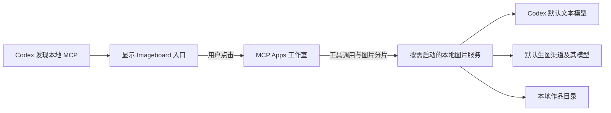

# Codex Imageboard

复用用户现有 Codex API 配置的本地生图工作室。安装后从 **Codex 左侧 Imageboard 图标**打开，首次进入工作室时按需启动图片服务。

- 提示词理解与转换：使用 Codex 用户配置中的默认模型。
- 图片生成与编辑：默认使用扫描到的 Codex 渠道与 `gpt-image-2.5-flare`，也可添加自定义生图渠道、选择模型。
- 界面：单行顶部导航、作品库、历史记录，以及自动切换的黑白灰明暗主题。
- 平台：提供 macOS Apple Silicon、macOS Intel 和 Windows x64 安装包。
- 普通聊天生图（0.6.0 起）：在 Codex 主聊天中调用 Imageboard，异步获取图片并保存到同一作品库；详见[聊天生图接入](docs/chat-generation.md)。

[安装与升级](INSTALL.md) · [开发与构建](docs/development.md) · [问题原因与修复记录](docs/2026-10-11-integration-fixes.md) · [文档索引](docs/README.md)

## 安装使用

从本项目维护者取得对应系统的安装包，或按[构建指南](docs/development.md#构建安装包)生成。

| 系统 | 最近构建的安装文件 |
| --- | --- |
| macOS，M 系列芯片 | `Imageboard-0.6.2-mac-arm64.dmg` |
| macOS，Intel 芯片 | `Imageboard-0.4.1-mac-x64.dmg` |
| Windows，x64 | `Imageboard-0.4.1-win-x64.exe` |

本次 0.6.2 构建覆盖 macOS Apple Silicon；表中的 Intel 和 Windows 旧安装包不包含普通聊天生图，需另行构建对应平台新版。

首次运行 Imageboard 完成 MCP 注册，然后重新打开 Codex，在左侧「更多」中找到 Imageboard 并固定一次。以后直接打开 Codex、点击侧栏图标即可使用。安装包内置运行环境，普通用户不需要 Node.js、npm 或独立 Codex CLI。

需要支持**本地 MCP Apps 全局入口**的 Codex 桌面版本，以及能够访问相应模型的 API 凭据。仅登录 ChatGPT 不等于拥有 Images API 的调用权限。详细步骤、签名状态和卸载方法见 [INSTALL.md](INSTALL.md)。

## 功能

| 功能 | 支持范围 |
| --- | --- |
| 文生图与提示词整理 | 生成前优化、单独预览和编辑提示词、关闭优化后直接生成 |
| 简洁输入框 | 左侧「＋」添加参考图，缩略图可预览、移除；文字与附件自适应展开 |
| 参考图与图生图 | 上传、拖拽、粘贴，最多 16 张，每张 20 MB；静态 PNG、JPEG、WebP；新上传图片统一作为参考图 |
| 多图理解 | 在提示词中描述每张参考图的用途，由模型结合图片理解需求 |
| 附件编辑 | 点击缩略图后打开标注、添加评论、移除背景、擦除、调整大小（1:1、3:4、9:16、4:3、16:9）；支持缩放与下载 |
| 位置评论 | 点击图片定位，Enter 或箭头保存；发送时保留图像编号、百分比坐标和评论，历史中可回看 |
| 连续编辑 | 从任意作品或方案继续修改，保留原版本并形成分支 |
| 结果分栏编辑 | 图片左下角「编辑」打开左右布局；复用附件工具并增加局部重绘、扩图 |
| 局部重绘 | 从生成结果进入；画笔、框选、擦除、撤销、清空；通过蒙版保留选区外的原图像素 |
| 扩图 | 从生成结果进入；设置上下左右扩展比例，补全新增区域，恢复原图所在区域 |
| 自然语言修改 | 通过提示词描述风格、颜色、文字、背景等修改；输入框不展示编辑功能菜单 |
| 多方案与导出 | 1 / 2 / 4 张；PNG、JPEG、WebP；透明背景和有损格式压缩质量 |
| 作品管理 | 版本对比、重命名、标签、收藏、搜索、回收站及恢复 |

默认模型需支持视觉输入才能看图优化；可关闭「结合参考图理解需求」仅整理文字，参考图仍会发送给生图模型。图片会校正 EXIF 方向并移除元数据。透明背景不使用 JPEG；JPEG 等有损导出会产生压缩误差。

画质可在输入框右侧直接选择；比例、张数、格式、背景和提示词优化位于「生成设置」。简洁输入框与附件工具自 0.4.0 起提供；[生成结果分栏编辑](docs/2026-10-11-result-editor.md)自 0.4.1 起提供。

标注和固定比例调整在本地生成新的参考图片，调整比例时保留完整画面，新增画布区域透明；点击「移除背景」会把当前图片和固定提示词直接发送到聊天，展示生成进度及结果；擦除通过生图接口处理选区。保存评论只更新当前草稿，点击「发送」才生成图片。每张参考图最多 20 条评论，每条 300 字，全部评论合计不超过 8000 字。详见[输入框与附件编辑说明](docs/2026-10-11-attachment-editor.md)。

快捷编辑效果取决于模型。扩图和生成尺寸受网关及模型约束，网关也可能不接受全部画质参数。

## 从源码快速启动

建议使用 **Node.js 24 LTS，至少 24.5.0**。取得本项目源码后，在项目根目录执行：

macOS 终端：

```sh
npm ci
npm run build:ui
npm test
npm start
```

Windows PowerShell：

```powershell
npm.cmd ci
npm.cmd run build:ui
npm.cmd test
npm.cmd start
```

浏览器打开 [http://127.0.0.1:47824](http://127.0.0.1:47824)。此模式默认把数据保存在仓库 `.data/`，按 `Ctrl+C` 停止。测试使用模拟网关，不消耗真实模型额度；在界面中主动生成或优化提示词会调用配置的真实 API。

需要把源码版注册到 Codex 时，在项目根目录执行：

```sh
npm run codex
```

Windows 使用 `npm.cmd run codex`。该命令构建 UI、写入用户 MCP 配置并安装配套 Imageboard Skill，不会启动 Codex。注册后重新打开 Codex，可在普通聊天中说“用 Imageboard 生成一张图片”，也可按安装指南固定工作室入口；必须保留当前仓库和 Node 可执行文件的路径。

**源码 MCP 模式默认使用系统 Imageboard 数据目录，而浏览器模式默认使用 `.data/`。**自定义目录、热更新和调试方法见[开发指南](docs/development.md)。

## 配置读取规则

每次创作读取 `$CODEX_HOME/config.toml`，未设置 `CODEX_HOME` 时使用 `~/.codex/config.toml`；Windows 对应 `%USERPROFILE%\.codex\config.toml`。扫描渠道完全只读，不能在 Imageboard 中编辑、删除或覆盖。

### 自定义生图渠道（当前源码）

打开右上角「模型与连接配置」→「新增渠道」，填写名称、Base URL、API Key，点击「拉取模型」后搜索选择生图模型，也可直接填写模型 ID。保存后点击「设为默认」启用；新增渠道不会自动切换默认选择。

- 自定义渠道支持编辑和删除。编辑时 API Key 不回显，留空保留原值。
- 默认选择重启后保留；重新读取 Codex 配置不覆盖默认选择。删除当前默认自定义渠道后恢复 Codex 扫描渠道，若其不可用需另选渠道。
- 自定义渠道仅负责图片生成、编辑、去背景、擦除和扩图；提示词优化仍使用 Codex 模型。Codex 配置不可用时可关闭优化直接生图。
- 运行中的任务固定使用开始时的配置；重新生成、继续编辑使用当时的默认渠道。
- 支持 OpenAI 兼容 `GET /models`、`POST /images/generations`、`POST /images/edits`，图片须返回 `b64_json`。模型列表不保证所选模型具备生图能力或支持全部图片参数。
- 配置保存在当前数据目录的 `channels.json`（含 API Key，文件权限 `0600`），不写回 Codex，不进入作品记录、页面存储或响应。备份该文件时按凭据文件保管。

此功能已包含在 0.6.0 macOS Apple Silicon 安装包中；0.4.1 旧安装包不包含。

### 扫描渠道

| 配置项 | 用途 |
| --- | --- |
| `model` | 提示词理解模型，沿用用户配置 |
| `model_provider` | 当前服务提供方 |
| `model_providers.<id>.base_url` | 提示词 API 地址；扫描渠道作为默认时也是图片 API 地址 |
| `wire_api = "responses"` / `"chat"` | 文本使用 Responses / Chat Completions |
| `experimental_bearer_token` / `env_key` | Provider 的 Bearer 凭据或凭据环境变量名 |
| `http_headers` / `env_http_headers` | 附加请求头及从环境变量读取的请求头 |

凭据按以下顺序解析：

1. Provider 的 `experimental_bearer_token`。
2. 明确声明的 `env_key`。该变量缺失时报告错误，不回退到其他 Provider 的密钥。
3. 仅当 Provider 为 `openai` 或声明 `requires_openai_auth` 时，回退到 `OPENAI_API_KEY` 或 Codex `auth.json` 的 API Key。

包含认证信息的静态请求头也可使用。暂不支持动态 `auth` 凭据解析器，也不会把 ChatGPT OAuth token 转作 Images API Key。

支持 `IMAGEBOARD_CODEX_PROFILE` 或配置中的 `profile`；读取同目录 `<profile>.config.toml` 及 `[profiles.<name>]` 覆盖项。只读取用户级配置，不读取项目 Provider 配置，也不读取某个聊天窗口临时切换的模型。

顶部显示当前默认生图渠道与模型，配置可用状态不代表已完成网关连通性或余额检查。配置示例和环境变量说明见[安装指南](INSTALL.md#准备-codex-api-配置)。

## 运行与数据



MCP 发现和读取页面资源不会调用图片服务或生图 API。多个窗口复用同一个本地图片服务；服务在回环地址的随机端口监听，并使用临时令牌鉴权。空闲五分钟且没有生成任务后自动退出。

图片通过 256 KiB 分片传输，页面资源策略仅声明 `data:` 和 `blob:` 本地资源；页面 API 操作走 MCP。下载复用已有图片 Blob。输入的自定义 API Key 通过本地接口或 MCP 提交至后端；已保存的 API Key 和认证头不返回页面或写入作品记录。

默认数据位置：

| 模式 | 目录 |
| --- | --- |
| macOS 安装版 / 源码 MCP | `~/Library/Application Support/Imageboard/data` |
| Windows 安装版 / 源码 MCP | `%APPDATA%\Imageboard\data` |
| `npm start` / `npm run dev` | 仓库 `.data/` |

任务记录在 `jobs.json`，图片及元数据在 `assets/`，旧格式原图在 `images/`。历史格式迁移会保留原图，并在 `backups/` 保存迁移前记录。

| 环境变量 | 用途 |
| --- | --- |
| `IMAGEBOARD_DATA_DIR` | 指定图片和历史目录；源码注册时会写入 MCP 配置 |
| `IMAGEBOARD_PORT` | 普通浏览器服务端口，默认 `47824`；原生 MCP 服务使用随机端口 |
| `CODEX_HOME` | 指定 Codex 用户配置目录 |
| `IMAGEBOARD_CODEX_PROFILE` | 指定要读取的 Codex profile |

不要同时运行两个服务写入同一数据目录。退出面板不会主动停止正在运行的生成；停止任务只中断本地等待，上游可能继续处理并计费。

当前一次运行一个任务。多方案逐张请求并保存，以兼容忽略 `n > 1` 的网关；后续失败或取消时保留已完成方案。服务重启后，中断任务标记失败，不自动重复付费请求。只有根路径返回 404/405 时尝试 `/v1/` 前缀，不因超时或 5xx 自动重发生图请求。

## 开发状态与验证

0.6.2 保留聊天生成过程卡片，改用 MCP Apps fullscreen 展示原图，宿主不支持时回退为卡片内自适应预览，并移除 iframe 内部原图对话框。已通过 65 项回归测试和模拟宿主点击验证；详见 [0.6.2 验证说明](docs/0.6.2-testing.md)。

2026-10-26，0.6.0 macOS Apple Silicon 通过 65 项自动测试、成品应用自检、签名验证和 DMG 完整性检查。已完成本机覆盖安装，核对作品与渠道数据保留，并通过安装版 MCP 验证聊天工具发现和服务按需启动。自动生图测试使用模拟网关，未调用真实付费图片接口。

截至 2026-10-11，0.4.1 已通过 43 项自动测试、macOS arm64 安装包自检和 Rosetta 下的 macOS x64 安装包自检。两套 DMG 完整性与应用签名检查通过；Windows x64 已完成构建、压缩包完整性及静态检查，尚需 Windows 实机验收。

下载后的安装步骤与本次功能实测建议见 [0.4.1 测试说明](docs/0.4.1-testing.md)。

macOS 当前为 ad-hoc 签名，Windows 尚无 Authenticode 签名。构建脚本不会自动发布安装包；面向公众发布前还需准备签名、macOS 公证及实际发布渠道。项目当前许可证字段为 `UNLICENSED`。

参见[测试、受限页面验证和打包命令](docs/development.md)；历史问题的定位证据、修复文件和回归步骤记录在 [docs/](docs/README.md)。
