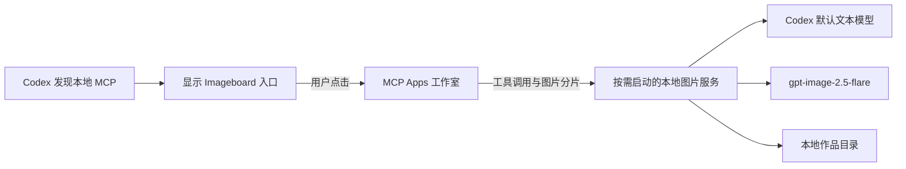

# Codex Imageboard

复用用户现有 Codex API 配置的本地生图工作室。安装后从 **Codex 左侧 Imageboard 图标**打开，首次进入工作室时按需启动图片服务。

- 提示词理解与转换：使用 Codex 用户配置中的默认模型。
- 图片生成与编辑：使用 `gpt-image-2.5-flare`。
- 界面：单行顶部导航、作品库、历史记录，以及自动切换的黑白灰明暗主题。
- 平台：提供 macOS Apple Silicon、macOS Intel 和 Windows x64 安装包。

[安装与升级](INSTALL.md) · [开发与构建](docs/development.md) · [问题原因与修复记录](docs/2026-10-11-integration-fixes.md) · [文档索引](docs/README.md)

## 安装使用

从本项目维护者取得对应系统的安装包，或按[构建指南](docs/development.md#构建安装包)生成。

| 系统 | 0.3.2 安装文件 |
| --- | --- |
| macOS，M 系列芯片 | `Imageboard-0.3.2-mac-arm64.dmg` |
| macOS，Intel 芯片 | `Imageboard-0.3.2-mac-x64.dmg` |
| Windows，x64 | `Imageboard-0.3.2-win-x64.exe` |

首次运行 Imageboard 完成 MCP 注册，然后重新打开 Codex，在左侧「更多」中找到 Imageboard 并固定一次。以后直接打开 Codex、点击侧栏图标即可使用。安装包内置运行环境，普通用户不需要 Node.js、npm 或独立 Codex CLI。

需要支持**本地 MCP Apps 全局入口**的 Codex 桌面版本，以及能够访问相应模型的 API 凭据。仅登录 ChatGPT 不等于拥有 Images API 的调用权限。详细步骤、签名状态和卸载方法见 [INSTALL.md](INSTALL.md)。

## 功能

| 功能 | 支持范围 |
| --- | --- |
| 文生图与提示词整理 | 生成前优化、单独预览和编辑提示词、关闭优化后直接生成 |
| 参考图与图生图 | 上传、拖拽、粘贴，最多 16 张，每张 20 MB；静态 PNG、JPEG、WebP |
| 多图理解 | 排序；编辑原图、主体、风格、构图、色彩、背景等用途；每张图附加说明 |
| 连续编辑 | 从任意作品或方案继续修改，保留原版本并形成分支 |
| 局部重绘 | 画笔、框选、擦除、撤销、清空；通过蒙版保留选区外的原图像素 |
| 扩图 | 设置上下左右扩展比例，补全新增区域，恢复原图所在区域 |
| 快捷编辑 | 风格转换、改色、修改文字、翻译、草图转实景、去背景、换背景 |
| 多方案与导出 | 1 / 2 / 4 张；PNG、JPEG、WebP；透明背景和有损格式压缩质量 |
| 作品管理 | 版本对比、重命名、标签、收藏、搜索、回收站及恢复 |

默认模型需支持视觉输入才能看图优化；可关闭「结合参考图理解需求」仅整理文字，参考图仍会发送给生图模型。图片会校正 EXIF 方向并移除元数据。透明背景不使用 JPEG；JPEG 等有损导出会产生压缩误差。

快捷编辑效果取决于模型。扩图和生成尺寸受网关及模型约束，网关也可能不接受全部画质参数。

## 从源码快速启动

建议使用 **Node.js 24 LTS，至少 24.5.0**。取得本项目源码后，在项目根目录执行：

macOS 终端：

```sh
npm ci
npm run build:ui
npm test
npm start
```

Windows PowerShell：

```powershell
npm.cmd ci
npm.cmd run build:ui
npm.cmd test
npm.cmd start
```

浏览器打开 [http://127.0.0.1:47824](http://127.0.0.1:47824)。此模式默认把数据保存在仓库 `.data/`，按 `Ctrl+C` 停止。测试使用模拟网关，不消耗真实模型额度；在界面中主动生成或优化提示词会调用配置的真实 API。

需要把源码版注册到 Codex 时，在项目根目录执行：

```sh
npm run codex
```

Windows 使用 `npm.cmd run codex`。该命令构建 UI 并写入用户的 MCP 配置，不会启动 Codex。注册后按安装指南重新打开 Codex、固定入口；必须保留当前仓库和 Node 可执行文件的路径。

**源码 MCP 模式默认使用系统 Imageboard 数据目录，而浏览器模式默认使用 `.data/`。**自定义目录、热更新和调试方法见[开发指南](docs/development.md)。

## 配置读取规则

每次创作读取 `$CODEX_HOME/config.toml`，未设置 `CODEX_HOME` 时使用 `~/.codex/config.toml`；Windows 对应 `%USERPROFILE%\.codex\config.toml`。

| 配置项 | 用途 |
| --- | --- |
| `model` | 提示词理解模型，沿用用户配置 |
| `model_provider` | 当前服务提供方 |
| `model_providers.<id>.base_url` | 文本及图片 API 的共同服务地址 |
| `wire_api = "responses"` / `"chat"` | 文本使用 Responses / Chat Completions |
| `experimental_bearer_token` / `env_key` | Provider 的 Bearer 凭据或凭据环境变量名 |
| `http_headers` / `env_http_headers` | 附加请求头及从环境变量读取的请求头 |

凭据按以下顺序解析：

1. Provider 的 `experimental_bearer_token`。
2. 明确声明的 `env_key`。该变量缺失时报告错误，不回退到其他 Provider 的密钥。
3. 仅当 Provider 为 `openai` 或声明 `requires_openai_auth` 时，回退到 `OPENAI_API_KEY` 或 Codex `auth.json` 的 API Key。

包含认证信息的静态请求头也可使用。暂不支持动态 `auth` 凭据解析器，也不会把 ChatGPT OAuth token 转作 Images API Key。

支持 `IMAGEBOARD_CODEX_PROFILE` 或配置中的 `profile`；读取同目录 `<profile>.config.toml` 及 `[profiles.<name>]` 覆盖项。只读取用户级配置，不读取项目 Provider 配置，也不读取某个聊天窗口临时切换的模型。

界面「已读取 Codex 配置」仅表示配置可用，不代表已完成网关连通性或余额检查。配置示例和环境变量说明见[安装指南](INSTALL.md#准备-codex-api-配置)。

## 运行与数据



MCP 发现和读取页面资源不会调用图片服务或生图 API。多个窗口复用同一个本地图片服务；服务在回环地址的随机端口监听，并使用临时令牌鉴权。空闲五分钟且没有生成任务后自动退出。

图片通过 256 KiB 分片传输，页面资源策略仅声明 `data:` 和 `blob:` 本地资源；页面 API 操作走 MCP。下载复用已有图片 Blob。API Key 和认证头由本地后端使用，不返回页面或写入作品记录。

默认数据位置：

| 模式 | 目录 |
| --- | --- |
| macOS 安装版 / 源码 MCP | `~/Library/Application Support/Imageboard/data` |
| Windows 安装版 / 源码 MCP | `%APPDATA%\Imageboard\data` |
| `npm start` / `npm run dev` | 仓库 `.data/` |

任务记录在 `jobs.json`，图片及元数据在 `assets/`，旧格式原图在 `images/`。历史格式迁移会保留原图，并在 `backups/` 保存迁移前记录。

| 环境变量 | 用途 |
| --- | --- |
| `IMAGEBOARD_DATA_DIR` | 指定图片和历史目录；源码注册时会写入 MCP 配置 |
| `IMAGEBOARD_PORT` | 普通浏览器服务端口，默认 `47824`；原生 MCP 服务使用随机端口 |
| `CODEX_HOME` | 指定 Codex 用户配置目录 |
| `IMAGEBOARD_CODEX_PROFILE` | 指定要读取的 Codex profile |

不要同时运行两个服务写入同一数据目录。退出面板不会主动停止正在运行的生成；停止任务只中断本地等待，上游可能继续处理并计费。

当前一次运行一个任务。多方案逐张请求并保存，以兼容忽略 `n > 1` 的网关；后续失败或取消时保留已完成方案。服务重启后，中断任务标记失败，不自动重复付费请求。只有根路径返回 404/405 时尝试 `/v1/` 前缀，不因超时或 5xx 自动重发生图请求。

## 开发状态与验证

截至 2026-10-11，0.3.2 已通过 40 项自动测试、macOS arm64 安装包自检和 Rosetta 下的 macOS x64 安装包自检。Windows x64 已完成构建及静态检查，尚需 Windows 实机验收。

macOS 当前为 ad-hoc 签名，Windows 尚无 Authenticode 签名。构建脚本不会自动发布安装包；面向公众发布前还需准备签名、macOS 公证及实际发布渠道。项目当前许可证字段为 `UNLICENSED`。

参见[测试、受限页面验证和打包命令](docs/development.md)；历史问题的定位证据、修复文件和回归步骤记录在 [docs/](docs/README.md)。
