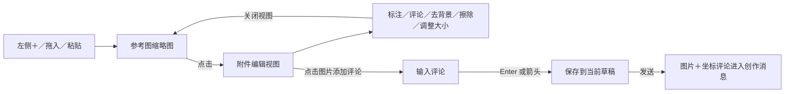

# 输入框与附件编辑调整

2026-10-11，0.4.0 功能改动；已按用户确认构建 macOS arm64、macOS x64、Windows x64 安装包。

## 交互

输入框不再展示局部重绘、扩图、图片用途、单图说明或排序工具。新上传图片统一为综合参考；画质保留在右侧，比例、张数、格式和优化设置折叠到「生成设置」。多行或有附件时展开，成功发送后清空附件草稿并收起输入框。

点击附件后才出现标注、添加评论、移除背景、擦除、调整大小工具；可以缩放、下载。生成结果原有的连续修改、局部重绘和扩图入口保留。

- 标注：画笔、颜色、撤销、清空，保存为新的 PNG 参考图。
- 评论：点击图片创建编号标记，Enter / 箭头保存，Shift + Enter 换行；可重新编辑或删除。Esc 取消未保存评论，关闭视图保留已保存评论。
- 去背景：点击后将当前图片和固定提示词作为一条聊天消息提交，关闭附件视图，进入正常生成进度和结果展示。提示词为「移除此图像的背景。保持所有前景主体不变且完整，边缘干净平滑。将背景设为透明。」只提交当前图片，使用 PNG / 透明背景，直接送生图模型，不混入其他草稿、图片评论或选区；可通过聊天区「停止生成」取消。模型未返回透明像素时显示现有警告。
- 擦除：涂抹后导出与原图等大的 alpha 蒙版，通过现有局部编辑服务处理；选区外像素由后端保留。
- 调整大小：按钮上方弹出五个固定比例，顺序为正方形 1:1、竖向 3:4、故事版式 9:16、横向 4:3、宽屏 16:9。无自定义宽高或比例输入；选择后保留完整画面，新增区域透明，长边最多 4096 像素。评论位置同步换算，反复切换比例复用原参考图，避免累积边框。菜单支持方向键、Home / End、Enter、Esc 和点击外部关闭。

标注和尺寸调整不调用模型。去背景和擦除会使用配置的 Images API；可取消本地等待。原始图片资产保留；标注、擦除及尺寸调整的结果更新参考图，去背景结果作为正常创作消息展示及保存。发送失败时保留原附件供重试。

## 评论数据

参考图新增可选 `comments: [{ x, y, text }]`。`x`、`y` 是以图片左上角为原点的 0–1 有限数，独立于显示尺寸、缩放倍数和滚动位置。显示及模型上下文统一转换为保留一位小数的百分比。

每张图最多 20 条、每条 1–300 字，全部图片评论合计不超过 8000 字。后端校验位置、类型、空白及数量上限，持久化到任务记录。连续编辑补入原图时，按资产 ID 保留对应评论，避免坐标指向错误图片。无文字提示词但有有效评论时允许生成。

保存评论不会创建任务；发送时同时提交原参考图片及结构化评论。生成上下文和提示词优化都会收到坐标定义、图像编号和评论。历史消息显示同样的文本，点击历史附件可只读查看标记。旧记录没有 `comments` 字段时仍能正常使用。

## 变更位置

| 文件 | 内容 |
| --- | --- |
| `web/index.html`、`web/style.css` | 紧凑输入框、缩略图及全屏附件工作区 |
| `web/reference-editor.js` | 位置评论、标注、擦除蒙版、尺寸调整、缩放及取消处理 |
| `web/app.js` | 草稿、附件编辑回调、请求提交、历史评论展示 |
| `server/jobs.mjs` | 评论校验、持久化、连续编辑关联、模型上下文 |
| `server/embed.mjs`、`server/index.mjs` | 浏览器模块路由及 MCP / 旧嵌入页的自包含脚本 |
| `test/editing.test.mjs` | 评论存储、优化与生成、父版本关联和非法输入回归 |

图标来自 Feather Icons 4.29.2（MIT），许可证随 `web/feather-icons-LICENSE.txt` 一起分发。

## 验证

- `npm test`：43 项通过；3 项新增测试覆盖评论生成、重启恢复、连续编辑关联和边界校验。
- 本地浏览器：＋多图上传、粘贴、移除、图片查看、多行输入、参数折叠、透明格式联动、评论 Enter / 箭头保存、缩放定位、只读历史、发送后收起输入框。
- 标注保存后检测到 880 个像素变化；五个固定比例输出均精确匹配，保留区域像素与原图完全一致，评论仍指向相同图像位置；关闭重开后再切换比例不会累积边框。
- 擦除接口验证 66,192 个选区外像素逐像素一致；去背景通过模拟服务验证选中图片、固定提示词、PNG / 透明背景参数、聊天发送、取消、结果展示和原图回看。相关 `test/editing.test.mjs` 的 11 项测试通过。
- 桌面及 390 px 窄屏布局、评论框边界、宿主深色主题和浏览器错误日志检查通过。
- MCP 与旧嵌入文档包含完整附件编辑模块，内联脚本语法检查通过，不依赖外部图标或模块地址。

测试生图使用本地模拟服务，未请求真实模型；去背景、擦除及评论编辑的实际生成效果取决于用户配置的模型。0.4.0 两套 Mac 安装包通过运行自检、签名与 DMG 完整性检查；Windows 包通过构建、压缩包完整性与静态检查。真实 Codex 安装及模型效果由用户实测验收。参见 [0.4.0 测试说明](0.4.0-testing.md)。
