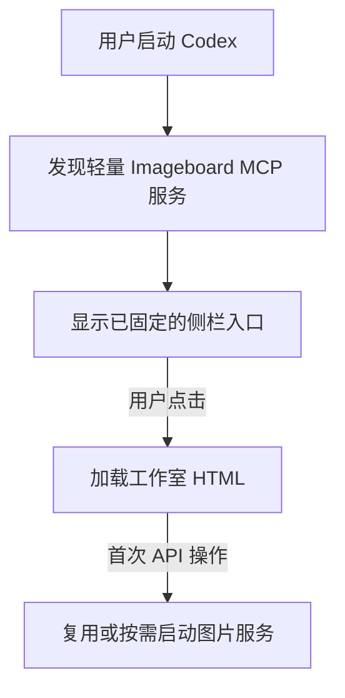

# Codex 集成与图片加载问题档案

记录日期：2026-10-11。覆盖版本：0.2.0 → 0.3.2。本文记录本轮排查确认的原因、实现方案和验证边界，供后续升级与回归使用。

## 问题概览

| 问题 | 受影响版本 | 修复版本 | 主要原因 |
| --- | --- | --- | --- |
| 菜单栏图标过大、必须先开 Imageboard、两个 Codex 实例 | 0.2.0 | 0.3.0 | 托盘尺寸与启动架构不合适，强制独立 profile / 新实例 |
| 能读取配置，但请求网关失败 | 0.3.0 | 0.3.1 | Electron 与系统 Node 的 CA 信任集合不同 |
| 深色背景和浅色控件混用 | 0.3.0 | 0.3.1 | 硬编码浅色值，缺少宿主主题同步 |
| 已完成的图片、作品缩略图和参考图显示破损 | 0.3.0–0.3.1 | 0.3.2 | 页面使用 `blob:`，MCP 资源策略却没有声明它 |

## 1. 启动顺序、重复实例与常驻图标

### 现象与定位证据

- 菜单栏 Imageboard 图标明显大于周围图标。
- 需要先启动 Imageboard，再由它启动 Codex。
- 系统出现两个 Codex 主进程：普通实例，以及带独立 `--user-data-dir` 和调试端口的实例。只有后者拥有 Imageboard。

0.2.0 将 36×36 PNG 直接作为普通模板图标加载，没有声明 Retina `@2x` 尺度或逻辑尺寸。

旧启动器只检查固定 CDP 端口 `9232`，没有先复用普通 Codex。macOS 使用 `open -n -a ...`，同时指定 Imageboard 的独立 profile，明确要求创建新实例。自动恢复逻辑又将「端口不可达、但 Codex 正在运行」视为需要重新启动调试实例。

Imageboard 自身的单实例锁只约束 Imageboard，无法阻止重复 Codex。托盘登录自启动默认关闭，所以普通 Codex 的启动也不会带起 Imageboard 服务。

### 对照 Taskboard 得到的结论

对照 Taskboard 的 `6a79ef522238ff11681cb85a9d803d19442a3d00` 版本：

- 已有可用 CDP 的 Codex 时，复用该进程和实际端口。
- 普通 Codex 已运行但没有 CDP 时，通过深链接打开该实例的原生浏览面板。
- 没有 Codex 时才启动；macOS LaunchServices 路径未使用我们的 `-n` 参数。

来源：[实例选择](https://github.com/chuspeeism/dashi-taskboard/blob/6a79ef522238ff11681cb85a9d803d19442a3d00/scripts/codex-injector.mjs#L3184)、[无 CDP 时的浏览面板入口](https://github.com/chuspeeism/dashi-taskboard/blob/6a79ef522238ff11681cb85a9d803d19442a3d00/scripts/codex-injector.mjs#L3040)。该分支不等于普通 Codex 无条件拥有被注入的固定侧栏。

### 解决方案

用户要求的是「Codex 左侧常驻入口，点击后再启动工作室」。0.3.0 改用当前 Codex 支持的本地 MCP Apps 全局入口：



工具定义通过 `_meta["openai/ui"].entrypoints: [{type: "global"}]` 声明入口，资源由 `resources/read` 提供。安装器只写入 MCP 注册并退出；取消托盘、主动启动 Codex、独立 profile 和 CDP 自动恢复。用户首次从 Codex「更多」固定入口，此后由 Codex 保存固定状态。

主要文件：[MCP 入口](../server/mcp.mjs)、[安装器](../desktop/main.cjs)、[配置注册](../desktop/install.mjs)、[按需运行时](../server/runtime.mjs)。

### 回归要求

- 正常打开 Codex 后可以发现入口；重复运行安装器不重复添加配置。
- 工具发现和读取 HTML 不启动图片服务，不调用模型。
- 多客户端首次请求只创建一个图片服务。
- 安装器不创建新的 Codex 进程，不要求托盘常驻。
- 0.2 升级时需退出旧托盘、正常退出旧的两个 Codex 实例；保留作品和旧 profile。

## 2. 网关 HTTPS 连接失败

### 现象与定位证据

页面能读取 Codex 配置，创作却提示：

> 无法连接当前 Codex 网关，请检查网络、证书和 base_url。

在同一台 Mac、同一份配置下，对同一网关的只读 `/models` 请求进行对照：

| 运行环境 | 结果 |
| --- | --- |
| 系统 Node 24.7.0 | HTTP 200 |
| Electron 44.7.0 内置 Node 24.21.0 | `UNABLE_TO_VERIFY_LEAF_SIGNATURE` |
| 内置运行时加入系统已信任证书后 | HTTP 200 |

当时两种运行时的 bundled CA 数量分别为 146 和 121；差异本身不证明具体缺少哪张证书，但系统信任补充前后的请求结果确认了信任集合问题。诊断没有调用生图接口，没有输出凭据。

### 原因

安装版以 Electron 的 Node 模式执行后端，其默认 CA 集合与开发机 Node 不完全相同。原实现没有加入系统已信任证书，又将底层连接异常统一改写为一个笼统错误，掩盖了证书校验失败的具体原因。

「已连接 Codex 配置」也容易被误解为网关已经可达；实际该状态仅检查配置是否可解析。

### 解决方案

[server/network.mjs](../server/network.mjs) 在请求前合并：

```js
[
  ...tls.getCACertificates('default'),
  ...tls.getCACertificates('system'),
]
```

去重后调用 `tls.setDefaultCACertificates()`。保留默认及额外 CA，同时继续执行证书链和主机名校验。没有关闭 TLS 校验，也没有自动安装新的系统信任证书。

[Provider](../server/provider.mjs) 根据异常链中的安全错误码区分证书、DNS、拒绝连接和超时；不把上游原始错误文本或凭据显示给页面。配置状态改为「已读取 Codex 配置」。

### 验证结果与边界

- 更新后的本机安装包访问实际网关 `/models` 返回 HTTP 200。
- [TLS 测试](../test/network.test.mjs)验证：不可信证书仍拒绝；加入模拟系统信任后成功；域名不匹配仍拒绝；默认 CA 保留。
- 只读连通性检查不证明模型权限、余额或完整生图链路可用。
- 使用系统 CA API 需要较新的 Node；开发统一推荐 Node 24.5.0 及以上，避免旧 Node 22 小版本差异。

## 3. 深浅主题混用

### 现象与原因

Codex 为深色界面时，工作室主区域呈深色，但导航、输入框、错误提示和部分弹窗仍为白色；部分深色文字在黑色背景上无法辨认。

旧 CSS 大量写死浅色背景和文字，HTML 声明 `color-scheme: light`，同时没有处理 MCP 宿主的主题初始化和变化通知。

### 解决方案

- [style.css](../web/style.css)统一为黑白灰语义变量，覆盖导航、画布区域、输入区、状态、弹窗和编辑器。
- [theme.js](../web/theme.js)独立页面读取 `prefers-color-scheme` 并监听变化。
- [MCP 客户端](../web/mcp-client.src.js)读取宿主初始主题，响应 `onhostcontextchanged`；内嵌页面优先跟随 Codex。
- 显式设置页面各主要区域的前景与背景，避免宿主样式和局部硬编码相互混用。
- 编辑选区改用黑白斜纹覆盖；保存蒙版仍按 alpha 表达选区，图片本身不做灰度转换。

### 验证结果与边界

在浏览器 MCP 宿主模拟页中切换明暗主题，确认导航、主区域、输入框、弹窗和主按钮同步变化。深色页面背景为 `rgb(23, 23, 23)`、主体文字为 `rgb(242, 242, 242)`；浅色页面为白底深色文字。

普通主题截图只能验证配色，不能替代受限宿主中的图片资源加载测试；后一项是下面的问题。

## 4. 图片无法正常加载

### 现象

任务显示「已完成」，作品数量、尺寸和提示词正常，但工作室结果、作品库缩略图、历史版本和参考图只显示破损图片及替代文字。

### 定位证据

1. 检查当时已有的 10 张作品，全部可从磁盘解码，最大文件约 6.24 MB。
2. 通过安装版 MCP 按 256 KiB 分片读取每张图，重组后的 SHA-256 与磁盘原图全部一致。
3. 前端将返回的字节转为 Blob，并使用 `URL.createObjectURL()` 生成 `blob:` 地址。
4. MCP 资源的 `resourceDomains` 原来为空，没有声明这些本地图片地址。
5. 在隔离且禁止页面联网的验证页复现：旧策略 0/10 张加载成功；声明本地图片资源后，滚动触发懒加载，10/10 张均成功解码。

结论：文件保存与 MCP 二进制传输正常，失败发生在页面将图片地址交给浏览器加载的阶段。

### 解决方案

[server/ui-policy.mjs](../server/ui-policy.mjs)统一声明页面资源策略：

```js
{
  connectDomains: [],
  resourceDomains: ['data:', 'blob:'],
}
```

该声明由 MCP `resources/read` 返回的 HTML 内容 `_meta.ui.csp` 提供。只开放本地数据资源，页面 API 请求继续通过 MCP 工具转发。

下载原来还使用 `fetch(blobUrl)` 重新取得图片，这会触发 `connect-src` 限制。[web/app.js](../web/app.js)改为一起缓存原始 Blob 和显示 URL，直接把 Blob 交给宿主下载接口，不再为下载发起页面 fetch。

同时加入 MIME / 非空检查、图片显示失败提示、分片字节长度检查，以及卸载时释放 Blob URL。版本更新为 0.3.2，版本化资源 URI 和注册环境版本使新资源策略可重新发现。

### 验证结果

| 检查 | 结果 |
| --- | --- |
| 现有图片文件解码 | 10/10 成功 |
| MCP 重组字节与原图 SHA-256 | 10/10 一致 |
| 受限页面旧策略 | 0/10 成功，可复现破损图片 |
| 受限页面修复策略 | 10/10 成功，0 张解码失败 |
| 原图显示、双方案与参考图 | 验证通过 |
| 局部编辑器 | 原图成功加载，尺寸与原图一致 |
| 下载 | 验证样本 3,973,525 字节，与原图一致 |
| 历史记录 | 升级前后内容一致 |

这次验证使用已有作品，没有重新生成图片或消耗生图额度。

主要回归入口：[MCP 自动测试](../test/mcp.test.mjs)、[受限页面验证脚本](../scripts/verify-mcp-ui.mjs)。运行方法见[开发指南](development.md#受限页面图片回归)。

### 后续必须保留的检查

- 在带 CSP 和隔离 iframe 的环境中检查图片实际解码，不能只看 HTTP 成功或字节传输成功。
- 覆盖画廊懒加载、原图、参考图、编辑器和下载；保留原始 Blob，避免被禁止的二次 fetch。
- 页面资源策略只增加必需的本地类型，不开放任意网络域名。
- 更新安装后刷新 Imageboard；已完成的作品不需要重新生图。

## 本轮验收范围

0.3.2 的 40 项自动测试通过；macOS arm64 安装包运行自检通过，macOS x64 包在 Rosetta 下通过自检。Windows x64 安装器、应用和 sharp 原生依赖已完成构建及静态检查，尚未 Windows 实机验收。

图片浏览器回归使用实际已有图片与真实 MCP 传输，但宿主由本地测试页面模拟。该结果明确覆盖所复现的资源限制，不替代所有 Codex 版本、操作系统或实际模型接口的验收。

新问题应继续记录实际错误码、运行环境、最小复现和验证结果，避免仅凭「配置已读取」「任务已完成」或普通网页截图判断完整链路成功。
