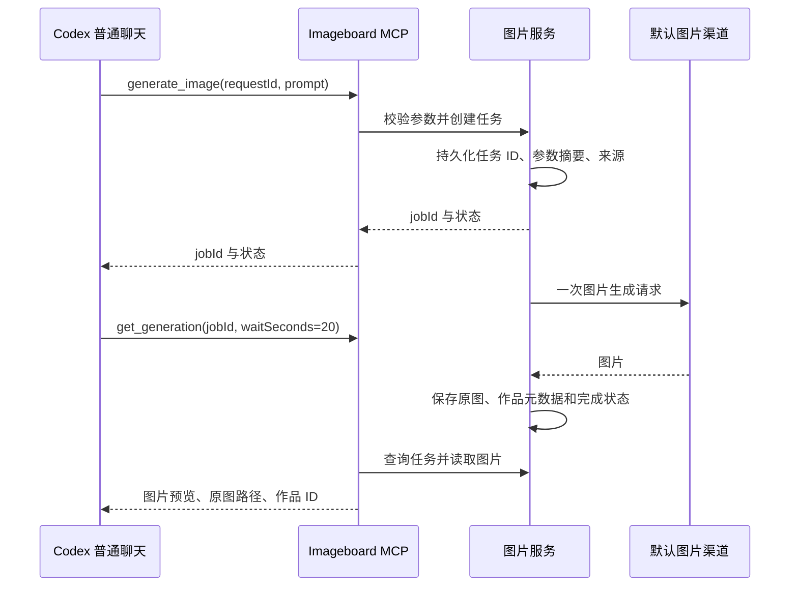

# Codex 普通聊天生图（0.6.1 / P0）

当前源码支持在 Codex 主聊天窗口说“用 Imageboard 生成一张咖啡店海报”，由 Codex 整理需求，调用 Imageboard 生成图片并在聊天展示。图片同时保存在现有作品库，无需先打开工作室。

本能力与工作室内部的[对话式生图](conversational-generation.md)使用同一图片服务、默认生图渠道及数据目录。P0 支持单张文生图；聊天参考图、连续修改、任务取消、历史检索、多任务排队和高级编辑属于后续范围，工作室已有功能仍可使用。

0.6.1 修复“工具已经返回图片，但聊天最终回复只有已保存”的缺口，并为创建工具绑定独立的 MCP 创作卡片。图片 Markdown 是最终回复的必要内容，不能把工具预览当作聊天图片已经展示。

## 启用

源码目录执行 `npm run codex`（Windows 使用 `npm.cmd run codex`），然后重新打开 Codex 或重启 MCP 连接。注册命令会同时安装：

- `imageboard` MCP：保留工作室入口，增加 `generate_image` 和 `get_generation`。
- `$CODEX_HOME/skills/imageboard`：聊天调用规则；未设置 `CODEX_HOME` 时使用 `~/.codex/skills/imageboard`。

安装版用户运行 0.6.1 Imageboard 一次即可完成上述注册，日常使用不需要终端命令。本次已提供 macOS Apple Silicon 安装包。

如果旧图片服务仍在运行，先等待现有任务完成，关闭工作室，等待空闲服务退出（约五分钟）后再使用新版。仅刷新页面不会加载新的后端路由。0.5.0 及更早的安装包不包含本功能。

Skill 安装不会修改用户默认的生图工具规则。用户指定 Imageboard 时使用本流程；未指定时遵循已有默认规则。只讨论功能、索要提示词、开发代码时不会要求生图。已有同名自定义 Skill 或用户修改过的托管文件会被保留，安装程序会提示手动合并；卸载只删除未修改的托管文件，作品保留。

## 工具协议

| 工具 | 参数 | 结果 |
| --- | --- | --- |
| `generate_image` | 必填 `requestId`（小写 UUID）、`prompt`（1–8000 字）；可选 `size`、`quality`、`format`、`background` | 快速返回 `jobId`、状态和生成参数，并关联创作卡片资源，不等待生图完成 |
| `get_generation` | 必填 `jobId`；`waitSeconds` 默认 20，范围 0–20；`includeImage` 默认 true | 状态、错误、原图路径、`display.terminal`、`display.ready` 与最终图片 `display.markdown`；结束且有图片时附带 WebP 预览 |

`jobId` 等于创建时的 `requestId`，即使创建响应丢失，也能用提交前已知的 ID 查询。每次新创作使用新的 UUID；同一次请求重试必须保持 ID 和参数不变。

默认尺寸、画质、背景为 `auto`，格式为 `png`。支持的尺寸与画质通过工具 schema 提供，与工作室一致；实际是否支持取决于所选生图模型。透明背景不能使用 JPEG。首版固定生成一张图片，直接使用 Codex 提供的完整提示词，不再次调用提示词优化模型。



结果通过 MCP `structuredContent` 返回，文本内容明确说明当前状态、下一步和最终回复应插入的图片 Markdown；图片预览通过标准 `image` 内容返回。预览最大边长 1024 像素，原图不会因此缩小。最终回复必须直接插入 `display.markdown`，例如 ``，不加代码围栏；即使已调用 `image()`，也不能只说已保存。不能直接嵌入工作室内部的 `/api/assets/...` 相对地址。

## 创作卡片与宿主兼容

`generate_image` 绑定 `ui://imageboard/generation-<版本>.html`，使用 MCP Apps `_meta.ui.resourceUri`，同时提供兼容的 `openai/outputTemplate`。卡片接收任务通知后独立调用只读的 `get_generation`，显示动画、真实耗时和已完成方案数，结束后原位显示图片，并支持原图预览与下载。`get_generation` 本身不绑定新卡片，避免每次轮询产生重复卡片。

卡片复用已有 MCP 图片分片传输，不在页面直接访问网关或本地 HTTP 服务，不携带 API Key。失败状态会停止轮询；短暂连接错误有次数限制的重试，读图失败允许重新读取已有结果，不重新生图。

宿主必须支持 MCP Apps 的工具关联界面，才能显示这张卡片；实际显示位置由宿主决定，不能仅凭协议注册成功宣称它已出现在 Codex 聊天气泡中。没有内嵌界面支持时，助手仍须用文字说明进度，并在最终回复中展示图片 Markdown。浏览器模拟宿主的测试不等于真实 Codex 主聊天界面验收。

## 去重与恢复

- 创建请求在服务内串行验收，任务持久化成功后才调用图片接口。规范化参数的 SHA-256 摘要保存在任务记录中；相同 ID 与参数返回原任务，相同 ID 与不同参数返回 409。
- 去重检查先于繁忙状态及渠道配置读取。原任务完成或失败后、默认渠道改变后、服务重启后，重试仍返回原任务，不重复调用图片接口。
- 创建连接中断时，工具返回用于恢复的 ID。先查询；确认不存在后可以用相同 ID 和参数重试。失败、取消或被回收的任务不会自动重新生成。
- 服务重启会将未完成任务标记失败，不自动重放。重新创作必须是用户的新请求并使用新 ID。
- 当前服务一次运行一个任务；新的不同请求遇到繁忙状态返回 409，不进入后台队列。
- 查询最多等待 20 秒，客户端断开后清理等待监听器。图片预览读取失败会保留任务结果和原图路径，重试查询即可，不需要重新生图。

任务仍写入 `jobs.json`，图片仍写入 `assets/`。新增任务字段为 `source: "codex-chat"` 和 `requestHash`，不保存 API Key 或请求认证头。现有作品管理接口可以重命名、收藏或回收这些图片；聊天查询不会返回已移入回收站的作品。

## 验证

```sh
node --test test/chat-generation.test.mjs test/mcp.test.mjs test/desktop.test.mjs
npm test
node desktop/self-test.mjs
node scripts/verify-chat-ui.mjs
```

自动测试使用临时数据目录及本地模拟图片网关，覆盖实际 stdio MCP 调用、并发去重、失联恢复、重启恢复、错误处理、长轮询断开、持久化失败、预览解码、作品保存及 Skill 安装保护，不消耗真实模型额度。

`verify-chat-ui.mjs` 在 `http://127.0.0.1:47826` 提供隔离的 MCP 模拟宿主，所有生成均使用本地测试图片；可验证生成中到完成的自动切换、失败、读图重试、下载、深浅主题和 360px 布局。下载结果写入 `work/chat-card/download.png`，停止脚本后删除临时任务目录，不影响用户作品。

Codex 桌面验收需加载新版 MCP 后，在普通聊天中请求图片，确认聊天实际展示、作品库可见，以及查询同一任务不会产生额外图片请求。协议测试和文件解码检查不等于已验证所有 Codex 版本的界面呈现。
